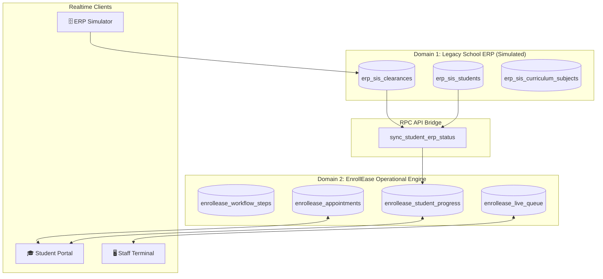

# 🎓 EnrollEase (`PC316v2`)
### Smart Campus Enrollment Appointment, Live Queuing, and Step-by-Step Enrollment Guidance System

EnrollEase is an intelligent full-stack enrollment platform designed to solve long student lines, counter congestion, and ambiguous manual enrollment steps in universities.

Built with modern HTML5, CSS3, ES6+ JavaScript, Supabase PostgreSQL, and Supabase Realtime, EnrollEase demonstrates a **Dual-Database Domain Architecture** simulating an external university Student Information System (SIS/ERP) seamlessly bridged with a student-facing operational queuing engine.

---

## 🌟 Key Features

1. **🧭 5-Step Enrollment Guide Roadmap**:
   - Step 1: Pre-Enrollment Clearance Verification (Clinic, Library, SAO, Cashier)
   - Step 2: Department Curriculum Advising & Subject Loading (IT Faculty Room 304 - Window 1)
   - Step 3: Registrar Document Evaluation & Encoding (Admin Bldg Windows 1 & 2)
   - Step 4: Cashier / UniFAST Free Higher Education Assessment (Admin Bldg Windows 3 & 4)
   - Step 5: Official COR Printing & School ID Validation (Admin Bldg Window 5)
   - Interactive drawer detailing exact room locations, required physical documents, and current status.

2. **⚡ 3-in-1 Live Defense Power Switchboard**:
   - **🎓 Student Portal (`dashboard.html`)**: Complete student experience for *Juan Dela Cruz* (Eligible Regular Student) and *Maria Santos* (Student with Clearance Hold).
   - **🖥️ Registrar / Staff Queue Controller (`staff-terminal.html`)**: Counter terminal featuring window selector, *Call Next Ticket*, *Recall Ticket* (with chime), *Complete Step & Unlock Next Stage*, and *Put on Hold*.
   - **🗄️ University SIS/ERP Simulator (`erp-simulator.html`)**: Control panel for the legacy school database (`erp_sis_*`) to toggle clearances and course advising in real time.

3. **🔔 Airport-Grade Queue Chimes & Realtime Sync**:
   - Integrated Web Audio API chime bell whenever a ticket is called to *Now Serving*.
   - Instantaneous updates across split screens or browser tabs using Supabase Realtime WebSockets and cross-tab BroadcastChannel.

4. **📚 Course Curriculum & `PC 316` Loading**:
   - Full schedule breakdown for BS Information Technology (BSIT) including `PC 316` (Advanced Web Systems & Full-Stack Development), units calculation, and printable official enrollment checklist slip.

---

## 🏛️ Dual-Database Architecture on Supabase



### Table Definitions:
- **Domain 1 (Simulated ERP)**:
  - `erp_sis_students`: Student master record, program, year level, tuition subsidy status, and SIS enrollment status.
  - `erp_sis_clearances`: Clinic, Library, SAO, Cashier, and Lab clearances with room locations and hold remarks.
  - `erp_sis_curriculum_subjects`: Major courses (including `PC 316`), units, schedule blocks, and advising approval.
- **Domain 2 (EnrollEase Operational DB)**:
  - `enrollease_workflow_steps`: 5 standard campus enrollment stages with instructions and document requirements.
  - `enrollease_student_progress`: Individual student progress per step (`completed`, `ready_to_book`, `in_queue`, `action_required`, `locked`).
  - `enrollease_appointments`: Scheduled counter appointments with reference passes (`EE-2026-XXXX`).
  - `enrollease_live_queue`: Real-time queue tickets (`ADV-001`, `REG-014`), assigned windows, priority lanes, and serving states.

---

## 🚀 Running Migrations on Supabase

1. Open your **Supabase Dashboard** -> **SQL Editor**.
2. Open `supabase/migrations/20261014_enrollease_dual_db.sql`.
3. Paste and run the SQL script. This will:
   - Create all `erp_sis_*` and `enrollease_*` tables.
   - Configure permissive demo RLS policies.
   - Enable `supabase_realtime` publication.
   - Install the `sync_student_erp_status(p_student_id)` RPC function.
   - Seed realistic CTU-style student records (`Juan Dela Cruz` [8240873], `Maria Santos` [8240874], `Carlo Mendoza` [8240875]) and schedule blocks.

---

## 💻 Local Testing & Classroom Defense Demo

You can preview the app using any static server or by opening the HTML files directly:

```powershell
# Using Python
python -m http.server 3000

# Using Node / npx
npx serve .
```

### Defense Walkthrough Script:
1. Open `dashboard.html` in **Window A** (logged in as *Maria Santos*).
   - Notice the red alert: `⚠️ Clearance Action Required in Campus SIS` (Medical & Library holds).
   - Notice Step 2 is **LOCKED**.
2. Open `erp-simulator.html` in **Window B**.
   - Select *Maria Santos*.
   - Click **"Clear All Holds"** or toggle Medical & Library to **Cleared**.
   - Notice Window A **INSTANTLY** turns green: `🟢 Synced with Campus SIS/ERP`, and Step 2 unlocks to **Ready to Book**!
3. In Window A, book an appointment or click **"Check-In & Issue Queue Ticket"**.
   - Notice ticket `ADV-004` is issued.
4. Open `staff-terminal.html` in **Window C**.
   - Select `Window 1 - IT Advising`.
   - Click **"📢 Call Next Ticket"**.
   - The airport chime plays in Window A and Window C, and Maria's ticket turns to **NOW SERVING**!

---

## ☁️ Zero-Error Vercel Deployment

This project includes a pre-configured `vercel.json` file. To deploy:

```bash
# Push to GitHub
git add .
git commit -m "Deploy EnrollEase PC316v2"
git push origin main
```

Import the repository in [Vercel](https://vercel.com) as a static site:
- **Framework Preset**: Other
- **Root Directory**: `./`
- **Build Command**: *(leave empty)*
- **Output Directory**: `./`

---

*Developed for PC 316 - Advanced Web Systems & Full-Stack Development.*
