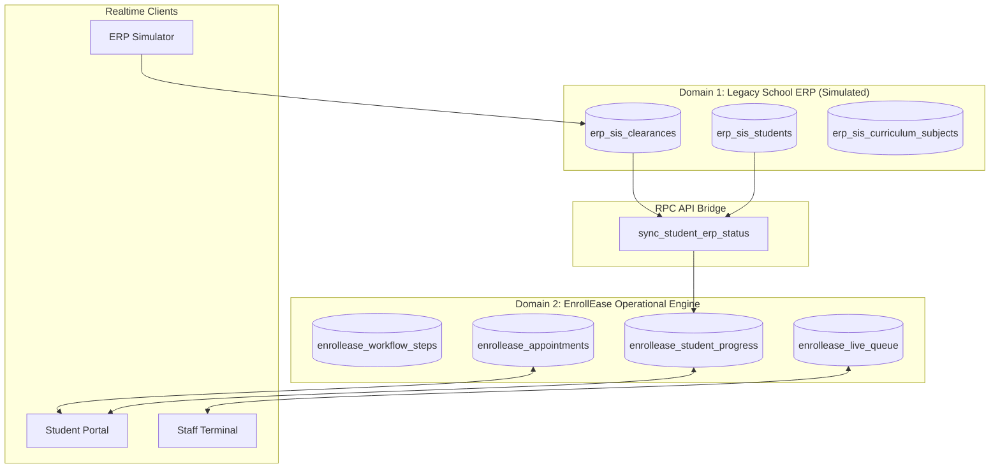

# EnrollEase (PC316v2)
### Smart Campus Enrollment Appointment, Live Queuing, and Step-by-Step Enrollment Guidance System

EnrollEase is an intelligent full-stack enrollment platform designed to eliminate long campus lines, counter congestion, and ambiguous manual enrollment steps in universities.

Built with HTML5, CSS3, Modern ES6+ JavaScript, Supabase PostgreSQL, and Supabase Realtime, EnrollEase demonstrates a **Dual-Database Domain Architecture** simulating an external university Student Information System (SIS/ERP) seamlessly bridged with a student-facing operational queuing engine.

---

## Key Features

1. **6-Stage Campus Enrollment Roadmap (2nd Year & 2nd Semester Flow)**:
   - **Step 1: Department Head Advising & Evaluation** (IT, BIT, HM, EDUC, IE heads): Direct walk-in academic consultation for checklist review and subject loading approval. No counter queuing required.
   - **Step 2: Campus Clinic Clearance** (Campus Health Services - Clinic Windows 1 & 2): Live queuing begins here (`CLN-xxx`) for annual physical examination validation and medical clearance slip issuance.
   - **Step 3: Student Affairs Office (SAO) Clearance** (Student Center - Room 204): Live queuing (`SAO-xxx`) for student conduct review, disciplinary clearance, and good moral verification.
   - **Step 4: University Library Clearance** (Learning Resource Center - 2nd Floor Circulation Desk): Live queuing (`LIB-xxx`) to verify book returns, clear overdue liabilities, and update library privileges.
   - **Step 5: Cashier & Accounting Assessment** (Administration Building - Cashier Windows 3 & 4): Live queuing (`CSH-xxx`) for UniFAST Free Higher Education billing validation or payment of assessed miscellaneous fees.
   - **Step 6: Registrar Document Evaluation & COR Printing** (Administration Building - Registrar Windows 1 & 2): Live queuing (`REG-xxx`) for official database encoding, official Certificate of Registration (COR) printing, and student ID semester validation sticker. Enrollment complete.

2. **3-in-1 Live Defense Power Switchboard**:
   - **Student Portal (`dashboard.html`)**: Complete student experience for *Juan Dela Cruz* (ID: 8240873, Eligible Regular Student) and *Maria Santos* (ID: 8240874, Student with Clearance Holds).
   - **Registrar & Staff Queue Controller (`staff-terminal.html`)**: Counter terminal featuring window selector (Clinic, SAO, Library, Cashier, Registrar), *Call Next Ticket*, *Recall Ticket* (with chime), *Complete Step & Unlock Next Stage*, and *Put on Hold*.
   - **University SIS/ERP Simulator (`erp-simulator.html`)**: Control panel for the legacy school database (`erp_sis_*`) to toggle clearances and course advising in real time.

3. **Airport-Grade Queue Chimes & Realtime Sync**:
   - Integrated Web Audio API chime bell whenever a ticket is called to *Now Serving*.
   - Instantaneous updates across split screens or browser tabs using Supabase Realtime WebSockets and cross-tab BroadcastChannel.

4. **Course Curriculum & PC 316 Loading**:
   - Full schedule breakdown for BS Information Technology (BSIT 2-A) including `PC 316` (Advanced Web Systems & Full-Stack Development), units calculation, and printable official enrollment checklist slip.

---

## Dual-Database Architecture on Supabase



### Table Definitions:
- **Domain 1 (Simulated ERP)**:
  - `erp_sis_students`: Student master record, 7-digit student ID (`8240873`), program, year level, tuition subsidy status, and SIS enrollment status.
  - `erp_sis_clearances`: Clinic, Library, SAO, Cashier, and Department Head clearances with room locations and hold remarks.
  - `erp_sis_curriculum_subjects`: Major courses (including `PC 316`), units, schedule blocks, and advising approval.
- **Domain 2 (EnrollEase Operational DB)**:
  - `enrollease_workflow_steps`: 6 standard campus enrollment stages with instructions, office locations, and document requirements.
  - `enrollease_student_progress`: Individual student progress per step (`completed`, `ready_to_book`, `in_queue`, `action_required`, `locked`).
  - `enrollease_appointments`: Scheduled counter appointments with reference passes (`EE-2026-XXXX`).
  - `enrollease_live_queue`: Real-time queue tickets (`CLN-001`, `SAO-012`, `REG-019`), assigned windows, priority lanes, and serving states.

---

## Running Migrations on Supabase

1. Open your **Supabase Dashboard** -> **SQL Editor**.
2. Open `supabase/migrations/20261014_enrollease_dual_db.sql`.
3. Paste and run the SQL script. This will:
   - Create all `erp_sis_*` and `enrollease_*` tables with 7-digit student ID primary keys.
   - Configure permissive demo RLS policies for smooth classroom presentations.
   - Enable `supabase_realtime` publication on `enrollease_live_queue`, `enrollease_student_progress`, `enrollease_appointments`, `erp_sis_clearances`, and `erp_sis_students`.
   - Install the `sync_student_erp_status(p_student_id)` RPC function.
   - Seed realistic CTU-style student records (`Juan Dela Cruz` [8240873], `Maria Santos` [8240874], `Carlo Mendoza` [8240875]) and schedule blocks.

---

## Local Testing & Classroom Defense Demo

You can preview the app using any static server or by opening the HTML files directly:

```powershell
# Using Python
python -m http.server 3000

# Using Node / npx
npx serve .
```

### Defense Walkthrough Script:
1. Open `dashboard.html` in **Window A** (logged in as *Maria Santos*, ID: 8240874).
   - Notice the status alert: `Clearance Action Required in Campus SIS` (Medical & Library holds).
   - Notice Step 2 (Campus Clinic) and Step 4 (Library) indicate `Action Required`.
2. Open `erp-simulator.html` in **Window B**.
   - Select *Maria Santos*.
   - Click **"Clear All Holds"** or toggle Medical & Library to **Cleared**.
   - Notice Window A **INSTANTLY** updates in real time: `Synced with Campus SIS/ERP`, and Step 2 unlocks to **Ready to Book**!
3. In Window A, book an appointment or click **"Check-In & Issue Queue Ticket"**.
   - Notice ticket `CLN-004` is issued for Clinic Window 1.
4. Open `staff-terminal.html` in **Window C**.
   - Select `Clinic Window 1`.
   - Click **"Call Next Ticket"**.
   - The airport chime plays in Window A and Window C, and Maria's ticket turns to **NOW SERVING**!

---

## Zero-Error Vercel Deployment

This project includes a pre-configured `vercel.json` file. To deploy:

```bash
# Push to GitHub
git add .
git commit -m "Deploy EnrollEase PC316v2"
git push origin main
```

Import the repository in [Vercel](https://vercel.com) as a static site:
- **Framework Preset**: Other
- **Root Directory**: `./`
- **Build Command**: *(leave empty)*
- **Output Directory**: `./`

---

*Developed for PC 316 - Advanced Web Systems & Full-Stack Development.*
